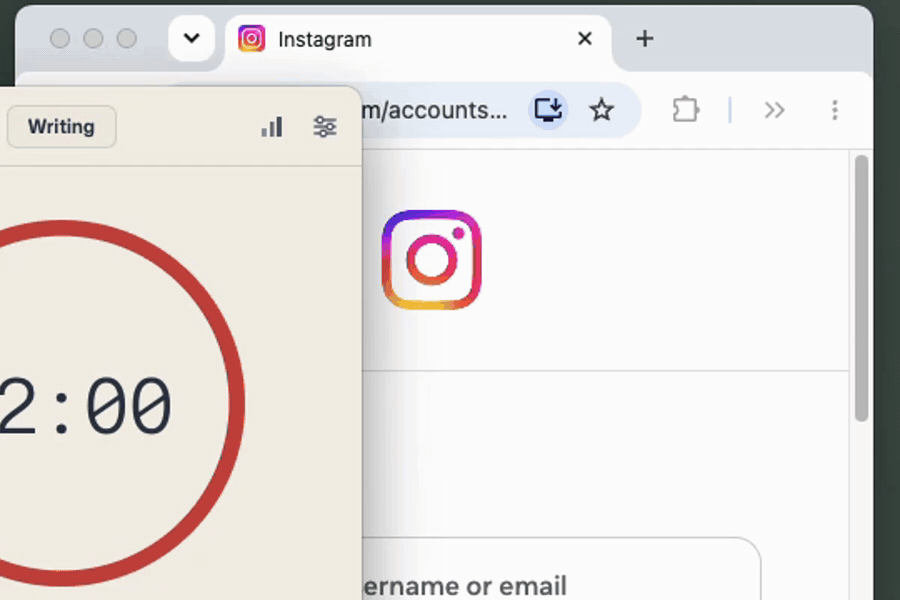

# grace.

A desktop Pomodoro timer that blocks the websites and apps you choose while you work.

[Download Grace](#install) · [Start your first session](docs/user-guide.md) · [Contributor guide](CONTRIBUTING.md)

## Watch a protected Writing session

Block Discord and Instagram for a two-minute Writing round. Watch them become available again on break, then see the first day of a focus streak in Statistics. The full walkthrough shows how to set up and test five blocking rules.

[Watch the full demo · 1:14](https://grace-focus.github.io/#watch-demo) · [View the timer still](docs/media/writing-timer.webp)

Recorded in Tart using a local macOS build reporting version 1.7.1. The downloadable nightlies have their own release notes and installers.

## Install

Open [Grace releases](https://github.com/samir-scripts/grace/releases), choose the newest published `-nightly.` prerelease, and download the asset for your machine. Nightlies are manual installs; the in-app updater does not deliver them.

| Platform | Installer |
| --- | --- |
| macOS (Apple silicon and Intel) | Universal `.dmg`. Open it and move Grace to Applications. |
| Windows x64 | `-setup.exe`. Run the installer. |
| Linux x64 | `.deb` for Debian/Ubuntu, `.rpm` for RPM-based systems, or `.AppImage` for a portable launch. |

Check the download against the release checksums and signatures before installing. See [package verification](SECURITY.md). Windows and Linux packages are experimental. macOS and Windows may show publisher warnings because nightlies are not notarized by Apple or signed with Windows Authenticode.

Test nightlies in a disposable account or VM on macOS and Linux, or a disposable machine or VM on Windows (the Windows installer is machine-wide). A nightly shares Grace's app identity and can reuse an existing profile. Back up your data and quit Grace before replacing an installation.

## Use Grace

- **Focus sessions.** Save a named timer routine and choose which websites or applications to block. Website blocking requires a connected [browser companion](docs/user-guide.md#set-up-website-blocking). Native app blocking depends on the operating system.
- **Statistics.** Open the chart icon to view today’s rounds, the week’s activity and streak, or the annual heatmap. [Read your focus history](docs/user-guide.md#read-your-focus-history)
- **Appearance.** Choose an interface style, font, and light/dark palettes. Resize the window for the compact timer. [Appearance and custom themes](THEMES.md)
- **Shortcuts and integrations.** Set local or global shortcuts and optionally expose the timer to a loopback WebSocket client. [Controls and integrations](docs/user-guide.md#shortcuts-and-integrations)

## Build or contribute

Grace uses SvelteKit and Svelte 5 in a Tauri 2 window. Rust owns the timer and enforcement. Session history and settings live in local SQLite.

- [Development setup and checks](CONTRIBUTING.md#development-setup)
- [Architecture and component responsibilities](docs/architecture.md)
- [Browser companion development](extensions/README.md)
- [Implementation and native verification records](plans/README.md)

## License

Grace is an independent fork of [Pomotroid](https://github.com/Splode/pomotroid) by Christopher Murphy. Grace and Pomotroid are distributed under the [MIT license](LICENSE).
