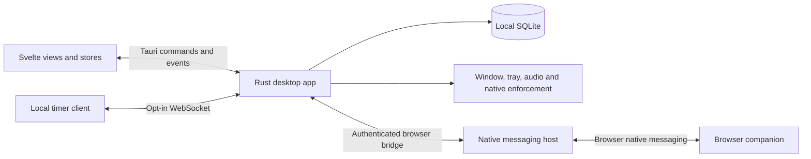

# Grace architecture

[Build and test Grace](../CONTRIBUTING.md) · [User guide](user-guide.md) · [Implementation records](../plans/README.md)

The desktop app serves a static SvelteKit interface inside one Tauri window. The UI sends commands and subscribes to events through a typed IPC module. The Rust process owns timer state, persistent data, and native integrations. Browser companions connect through their own native messaging path.

## User-facing components

| Component | Responsibility |
| --- | --- |
| [Main page](../src/routes/+page.svelte), [Titlebar](../src/lib/components/Titlebar.svelte), [navigation store](../src/lib/stores/navigation.ts) | Switch between timer, settings, and statistics in the same window. Initialize window controls and compact layout. |
| [Timer](../src/lib/components/Timer.svelte), [dial](../src/lib/components/TimerDial.svelte), [display](../src/lib/components/TimerDisplay.svelte), [footer](../src/lib/components/TimerFooter.svelte), [compact controls](../src/lib/components/MiniControls.svelte) | Render Rust timer snapshots and expose round actions. Compact mode keeps the dial and small controls. |
| [Session selector](../src/lib/components/SessionSelector.svelte), [session settings](../src/lib/components/settings/sections/SessionsSection.svelte), [application picker](../src/lib/components/settings/InstalledAppPicker.svelte) | Select the active profile, edit a session draft, and load installed application choices. Saving sends the draft to Rust for validation. |
| [Browser setup](../src/lib/components/settings/BrowserSetup.svelte), [protection notice](../src/lib/components/FocusEnforcementNotice.svelte), [emergency dialog](../src/lib/components/FocusEscapeDialog.svelte) | Connect and assign browser profiles, surface enforcement state, and submit emergency exit actions. |
| [Appearance](../src/lib/components/settings/AppearanceCustomization.svelte), [theme store](../src/lib/stores/theme.ts), [window material store](../src/lib/stores/windowMaterial.ts) | Apply palette and font changes and track the native material response. |
| [Daily](../src/lib/components/stats/DailyView.svelte), [weekly](../src/lib/components/stats/WeeklyView.svelte), [yearly](../src/lib/components/stats/YearlyView.svelte) | Read and present statistics for the selected time range. |

## Native services and boundaries

| Service | Responsibility |
| --- | --- |
| [Composition root](../src-tauri/src/lib.rs), [IPC handlers](../src-tauri/src/commands.rs), [TypeScript IPC](../src/lib/ipc/index.ts) | Register handlers and assemble the app. Mirror serialized Rust shapes in [frontend types](../src/lib/types.ts) and keep command names and event payloads aligned. |
| [Timer controller](../src-tauri/src/timer/mod.rs), [engine](../src-tauri/src/timer/engine.rs), [sequence](../src-tauri/src/timer/sequence.rs) | Coordinate timer and focus state, run the countdown, and choose the next round. |
| [Settings](../src-tauri/src/settings/mod.rs), [migrations](../src-tauri/src/db/migrations.rs), [queries](../src-tauri/src/db/queries.rs) | Store settings, session profiles and history in SQLite. Durations cross IPC in seconds. Volume is stored as 0–100 and exposed as 0–1. |
| [Focus controller](../src-tauri/src/focus/controller.rs), [enforcers](../src-tauri/src/focus/enforcer/mod.rs), [escape](../src-tauri/src/focus/escape.rs) | Validate and activate the selected policy, coordinate work and break transitions, and guard early release. |
| [Browser bridge](../src-tauri/src/focus/browser.rs), [authentication](../src-tauri/src/focus/browser_auth.rs), [native host](../src-tauri/src/bin/pomotroid-native-host.rs), [extension source](../extensions/focus/) | Coordinate browser policy and acknowledgements through authenticated local communication. |
| [Theme loading](../src-tauri/src/themes/mod.rs), [fonts](../src-tauri/src/fonts/mod.rs), [window material](../src-tauri/src/window_material.rs), [window views](../src-tauri/src/window_view.rs) | Load bundled and local resources, select platform material or fallback, and size the native window by view. |
| [Audio](../src-tauri/src/audio/mod.rs), [notifications](../src-tauri/src/notifications/mod.rs), [tray](../src-tauri/src/tray/mod.rs), [global shortcuts](../src-tauri/src/shortcuts/mod.rs), [local shortcuts](../src/lib/utils/localShortcuts.ts) | Handle sounds, system notifications, tray state, and keyboard input. Global shortcuts register in Rust. Local shortcuts remain in the frontend. |
| [Localization sources](../src/messages/), [locale state](../src/lib/locale.svelte.ts), [packaging configuration](../src-tauri/tauri.conf.json), [CI workflows](../.github/workflows/) | Generate translated messages, switch locale reactively, and build and verify platform artifacts. |

## Follow an interaction end to end

### Restarting a protected round

The timer calls `timerRestartRound()` through typed IPC. The command invokes `TimerController::restart_round()`, which sends a reset to the countdown engine. This action preserves the position in the sequence and the active focus lock. The controller test `round_restart_preserves_focus_and_emergency_reset_starts_first_work_round` checks these consequences. [Control](../src/lib/components/Timer.svelte) · [IPC](../src/lib/ipc/index.ts) · [Controller and test](../src-tauri/src/timer/mod.rs)

### Completing a round and reading Statistics

The controller starts a SQLite history row after the first tick. When a round completes it marks that row complete, advances the sequence, and emits a new snapshot. The Statistics views request aggregates through IPC. Their queries distinguish a started round from a completed work round. [Timer listener](../src-tauri/src/timer/mod.rs) · [Queries and tests](../src-tauri/src/db/queries.rs)

### Starting browser enforcement

The session settings send a profile to Rust. The focus controller checks readiness before starting a protected work round. The native host relays browser messages and the companion applies rules for the active policy. Acknowledgements let the desktop determine whether a required profile is ready or protection has been interrupted. The app also coordinates native app interception on supported platforms. [Focus controller and tests](../src-tauri/src/focus/controller.rs) · [Companion setup and tests](../extensions/README.md)

### Choosing Glass

The appearance control saves the choice and requests the native material. The window material store tracks the native acknowledgement. The native implementation chooses the available material or an opaque fallback according to platform and accessibility preferences. Palette, style, and font persist independently. [Material implementation](../src-tauri/src/window_material.rs) · [Appearance behavior](../THEMES.md) · [Rendered tests](../tests/appearance.test.mjs)

Browser fixtures verify the rendered UI and mocked IPC. Packaged Tart runs cover the native behavior documented in their evidence records. [Verification ledger](../plans/README.md)
