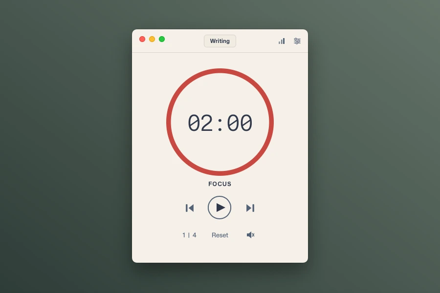
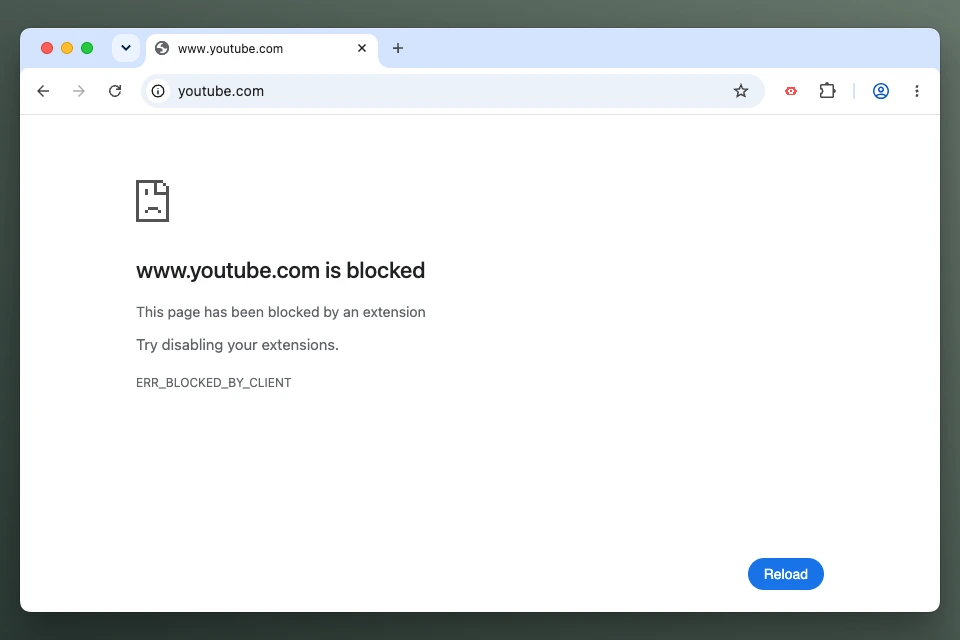
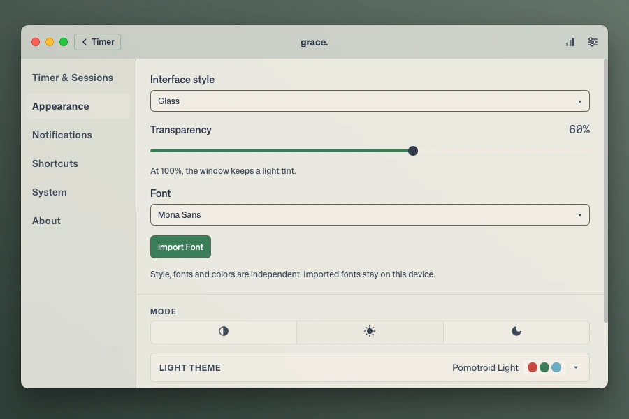
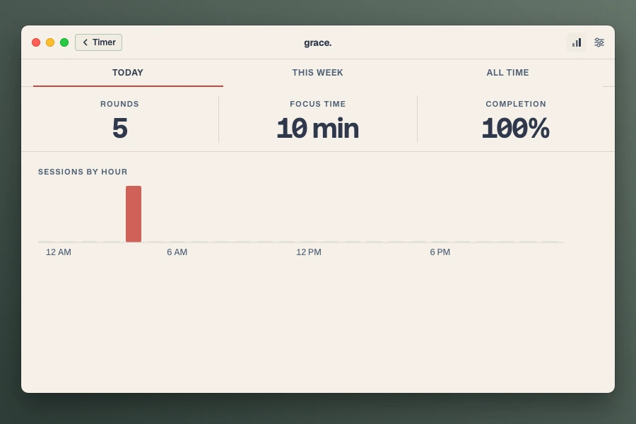

# Use Grace

[Install Grace](../README.md#install) · [Appearance and themes](../THEMES.md) · [Contributor guide](../CONTRIBUTING.md)

## Start a focus round

To try the default routine, open Grace and press **Play**. The dial starts counting down.

1. To create a routine, open the session selector at the top of the timer and choose **Manage Sessions…**.
2. Select **New Session** (+) in **Timer & Sessions**, enter a name, and set the work and break durations. Set **Rounds per Cycle** to choose how many work rounds lead to a long break. Choose **Save Changes**.
3. Return to the timer, choose the saved session, and press **Play**.

Use Tab and Enter to pick a routine by keyboard. After choosing, or after pressing Escape to dismiss the choices, focus returns to the session selector.

Edits stay in memory while you switch views. Choose **Save Changes** to keep them across a restart. If Grace asks whether to discard an edit, press Escape to keep editing.



Leave **Blocked Applications** and **Blocked Websites** empty for a timer-only session. The **Restart round** control to the left of Play restores the current countdown to its full duration and keeps its position in the cycle. A protected round keeps its blocking rules active. **Reset** is a separate action that restarts the cycle when the session allows it.

## Set up website blocking

1. In **Settings → Timer & Sessions → Browser Companions**, choose **Install Chrome Companion** for Chrome or **Set Up Extension** for Firefox or Zen. If the Firefox companion is already installed, choose **Update Extension** to install the bundled version.
2. Open the companion’s options in that browser. Read the sharing disclosure and choose **Accept & Connect**.
3. Back in Grace, assign each newly connected profile under **Connected Browser Profiles** to its browser. Mark a profile **Required for session** if you want every session with website rules to wait for that browser.
4. Add a domain such as `youtube.com` or `instagram.com` under **Blocked Websites**, choose **Add Domain** or press Enter, then **Save Changes** and start a focus round. Visit the domain from the paired browser. A new Chrome navigation can show a browser message that an extension blocked the request. An already-open tab can switch to the companion’s block page.



If Grace reports a disconnected required profile, open the companion and reconnect before retrying the session. Once an active browser session loses its protection, follow the notice shown in the timer. Use **Stop sharing and disconnect** in the companion, followed by **Remove Setup** in Grace, to remove the connection. Remove the extension in your browser if it is still installed. [Companion setup and removal details](../extensions/README.md)

## Block desktop applications

In **Timer & Sessions**, open **Select applications** in the blocked applications list, add an installed app such as Discord, and save. Start a focus round and attempt to open the app. Grace’s native application enforcement is available on macOS and Windows. On Windows the selection matches the executable name, including other processes with that name.

In **Timer & Sessions → Session Preferences**, enable **Temporarily unblock during breaks** to allow access during breaks in every session. Do a short test round to make sure your intended apps and websites behave as expected before relying on the session.

## Exit a protected session early

Open **Emergency Exit** from the locked timer. In **Hold**, press the button continuously for 60 seconds, or focus it and hold Space. Releasing early resets the countdown.

To use **Passphrase**, first save a passphrase of at least 30 characters under **Timer & Sessions → Emergency Exit Passphrase (Optional)**. During a locked session, choose **Passphrase** in the exit dialog, enter it in both fields, and select **End session**.

## Change the timer’s appearance

The [published nightly](../README.md#install) includes Blocky, Glass, font selection and the Transparency slider. The historical `v1.7.2-beta.1` has the earlier theme controls.

Open **Settings → Appearance** to select **Pomotroid**, **Blocky**, or **Glass**. Choose the font and light/dark palettes independently. Glass shows a **Transparency** slider. On systems that support native material, moving the slider lets you preview the tint. Other systems and relevant accessibility preferences use an opaque surface.

Drag a window edge inward until the timer enters compact mode. The dial and compact controls stay visible. Resize it outward to return to the full timer. [Appearance and custom theme reference](../THEMES.md)



## Read your focus history

Open the chart icon in the timer titlebar after completing a work round.



| View | What you can inspect |
| --- | --- |
| **Today** | Completed work rounds, focus time, completion rate, and a breakdown by hour. |
| **This Week** | Recent activity by day, the week’s total rounds, and the current streak. |
| **All Time** | Total work rounds, focus hours, best streak, and a year-by-year activity heatmap. |

Focus the annual heatmap and use Left or Right to move one week, or Up or Down to move one day. Grace announces the selected date and its completed rounds.

History is stored locally. **Settings → System** includes the action to clear timer history.

## Shortcuts and integrations

In **Settings → Shortcuts**, configure shortcuts for the timer. To cancel a recording by keyboard, tab to **Cancel recording** and press Enter. Local shortcuts apply while the Grace window has focus. Enable global shortcuts if you want to use them while another app is active.

Tab to a **More information** button next to a setting to read its help without toggling the setting. Escape dismisses the help. Tab and keys used in modal dialogs do not run local timer shortcuts.

For a local overlay or automation, enable **WebSocket Server** in **Settings → System**. The endpoint is `ws://127.0.0.1:1314/ws` by default. Use the port shown in Settings if you changed it. The connection is local and opt-in.

```js
const grace = new WebSocket('ws://127.0.0.1:1314/ws');
grace.addEventListener('open', () => grace.send(JSON.stringify({ type: 'getState' })));
grace.addEventListener('message', ({ data }) => console.log(JSON.parse(data)));
```

Run the example from a local Node.js runtime with WebSocket support. A successful request returns a `state` message containing the timer snapshot. Connected clients also receive `started`, `paused`, `resumed`, `roundChange`, and `reset` events. [Protocol source](../src-tauri/src/websocket/mod.rs)
