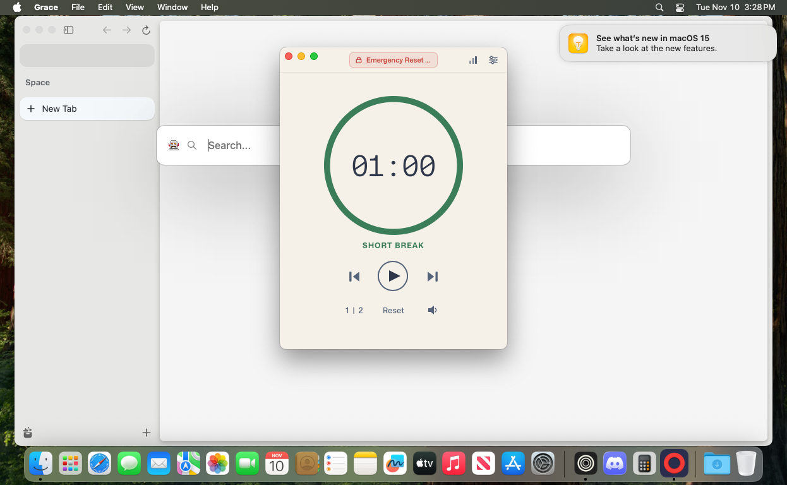

# Tart Zen and Discord acceptance — 2026-11-10

The reproducible guest setup and native acceptance checks are implemented. Provisioning succeeded independently on two clean Tart clones. Native tests exercised packaged Grace with Zen **1.24.1b**, Discord **0.0.421**, the persistent signed companion, and both isolated and matching extension configurations.

Follow the [developer runbook](../scripts/guest-focus/README.md). The [reviewed machine-readable results](evidence/tart-focus-acceptance-2026-11-10.json) contain versions, download and executable hashes, source provenance, verdicts, and artifact checksums. Raw probes intentionally remain observations until correlated with native UI and authenticated policy evidence.

## Observed results

| Check | Result |
| --- | --- |
| Public HTTPS during work, both extension passes | `example.com`, YouTube, Instagram, Reddit, `www.youtube.com`, and `old.reddit.com` blocked. Both allowed controls loaded. |
| Controlled HTTP | A verified `example.com` nonce navigation aborted without reaching the loopback proxy; allowed nonce controls loaded. |
| Existing page | A preloaded Reddit page became the exact signed companion block page. Native keyboard attempts repeated that target; counted as **one**, not three. |
| Discord | Open before protection, closed when protection started, and three relaunches stopped. Matching-pass exit times: **1098, 1044, 1018 ms**; no helper PIDs observed afterward. It stayed open again during breaks and after release. |
| Unselected app | Calculator remained usable during work. |
| Browser loss/recovery | Closing Zen paused the actual timer at **01:56**. Reconnection and native Retry resumed at **01:54**. |
| Natural completion | A repaired two-round cycle completed without skipping/resetting; profile saving and ordinary Quit succeeded afterward. |
| Protected round restart | Restart preserved the protected session; the same app PID survived ordinary Quit. |
| Emergency exit | Early release reset hold progress. A continuous hold released protection. The final repair reset **round 2 to round 1**, idle Work **01:00**, in the separate short fixture. |
| Statistics | Seven work attempts, six completed, 660 completed work seconds. The restarted attempt was closed as incomplete. |

The main fixture uses 120-second work, 60-second breaks, two rounds, automatic work start disabled, and break unblocking enabled. A separate 60-second fixture tested reset behavior without changing the main profile. Checks ran in batches across rebuilt debug bundles; the artifacts retain their build hashes. The second clone repeated provisioning; the native matrix ran on the first clone.

## Repairs discovered by testing

- Domain normalization now accepts uppercase HTTP(S) schemes and rejects wildcard/regex-like host syntax. The packaged UI displayed `Invalid domain: *.youtube.com`.
- Cycle completion now uses the sequence boundary before counters reset. The previous code left focus locked after a two-round timer cycle ended. A regression exercises all four break configurations through the real sequence/controller boundary.
- Emergency cycle reset and current-round restart have separate engine events. Emergency exit restores Work round 1; round restart preserves protection. Pending reset and generation guards reject stale starts/completions until the new duration is queued. Interrupted session rows are recorded as incomplete.

## Evidence and verification

Selected [evidence files](evidence/tart-focus-2026-11-10/), including [redacted timer/bridge events](evidence/tart-focus-2026-11-10/bridge-events.log), [natural unlock](evidence/tart-focus-2026-11-10/native-repaired-final-save.txt), [cycle reset](evidence/tart-focus-2026-11-10/cycle-reset.json), and [cleanup](evidence/tart-focus-2026-11-10/cleanup.json), accompany the summary.

- `npm run check`: zero errors and warnings.
- `npm test`: 4 unit and 61 extension tests passed.
- `npm run test:guest-focus`: 27 Python and 7 Node tests passed.
- Required Rust suite: **186 passed**, with the prescribed Accessibility skip and default opt-in ignores retained. A serial rerun passed after concurrent build activity caused a missing-dependency rustdoc error.
- Normal Tauri debug bundle passed its signed-artifact prebuild guard.
- Strict Clippy remains blocked by **13 pre-existing diagnostics** outside these repairs; no lint suppressions were added.

## Limits and cleanup

Mobile Instagram's redirected baseline remains inconclusive. Social-site HTTP requests upgraded through HSTS, so controlled HTTP claims cover the example domain; public HTTPS tests cover the social sites. Privileged BiDi inspection of extension pages was not enabled; native address-bar evidence covers one distinct existing target. One disabled Color Picker download was unavailable; all enabled matching extensions were present. Automatic reconnection after every desktop-app restart is not claimed: the final fixture required a Zen restart before Start correctly became available.

Guest-only Accessibility/System Events was explicitly approved. A later optional screen/audio capture bypass prompt was left unchanged; accessibility snapshots provide the final reset evidence. No host browser profiles, policies, or permissions were changed. Owned app/browser processes and listeners on 1420/1421/9222 were absent in two checks. All three owned guests are stopped; disposable fixtures are retained for inspection, and the original baseline/diagnosis guests remain stopped.
