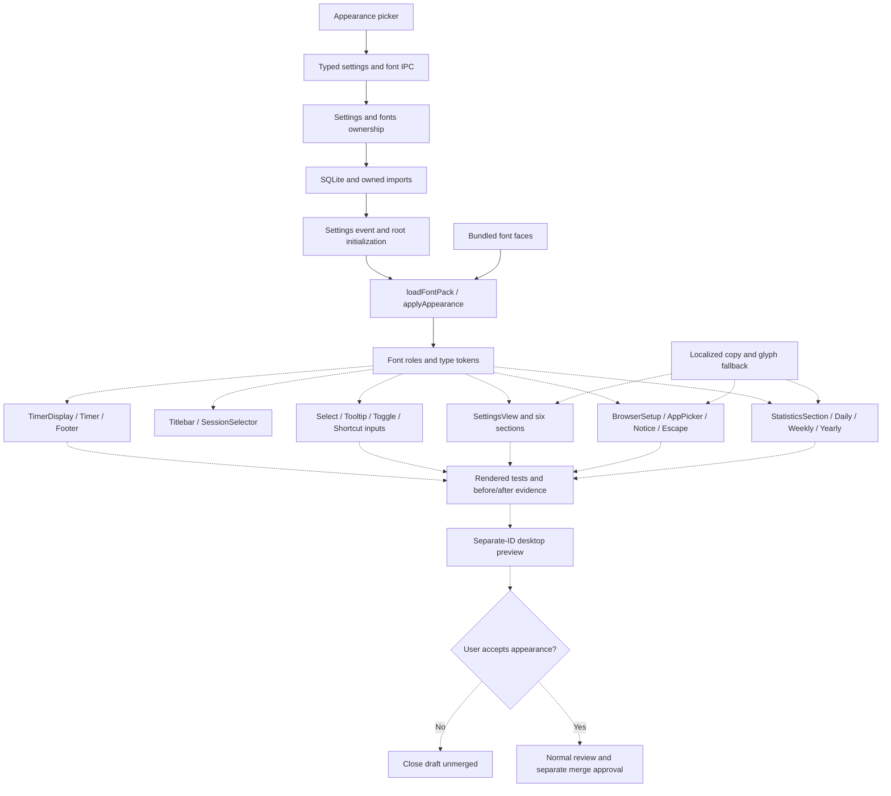

# Typography refinement implementation ledger

## Delivered on isolated review branch

`feat/typography-refinement` is based on appearance checkpoint `179d84dd79`; prerequisite PR #9 targets `dev`. The typography PR must remain draft until explicit visual acceptance. No merge, release tag or publication is authorized.

- Inter UI + JetBrains Mono numeric roles use existing bundled assets. Fresh/reset defaults use `inter`; valid saved selections are preserved by `INSERT OR IGNORE`. Removing an inactive imported font leaves selection intact; removing the active font restores the default.
- Built-in loading awaits both roles. Mona Sans Mono no longer advertises an unsupported width range. Local font display uses swap; native startup still awaits appearance before showing the window.
- Semantic control/body/support/heading/section/code/timer roles now cover timer/chrome, settings, shared controls, focus setup and emergency dialogs. Timer remains 2.8rem at normal width, weight 400 and zero tracking.
- Statistics use quieter values and 10px SVG annotations; yearly labels have a 40px inset/20px header without changing heatmap data.

## Impact map

Solid ownership edges are source-confirmed; dotted edges denote CSS/layout propagation and review gates.

## Verification and acceptance

[Evidence and runnable preview](evidence/typography-refinement/README.md) distinguish observed browser/DB proof from native limitations. Full npm checks, Rust tests, Clippy and isolated app build passed. Native interaction/optical acceptance, Windows/Linux and VoiceOver remain unverified; do not treat fixture IPC as native proof. Normal app data and original checkout were not modified.

Rulings: use a session-local execution ledger to keep the original checkout untouched; remove only credentials copied into new worktrees by the worktree tool. Typography contract tests were changed before implementation and observed failing, then passed; no thresholds or assertions were weakened to hide failures. An accidental body-role application to `html` was corrected before acceptance to retain the 16px rem basis.
